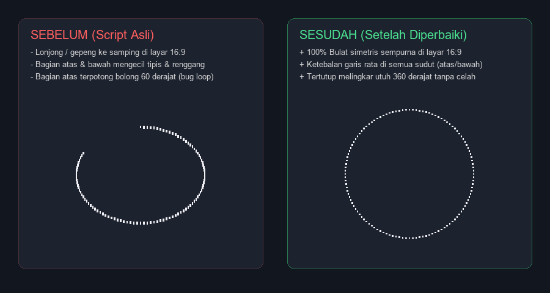

# Circle-Progress-Samp

Circular and shape progress bar library for SA-MP and open.mp.

This library allows you to create customizable radial and geometric progress indicators using player textdraws. It includes 16:9 aspect ratio correction so circles render round instead of stretched, uniform stroke sizing across all angles, and full 360-degree closure.

## Features

- Widescreen (16:9) aspect ratio correction
- Uniform stroke thickness (prevents thin or fragmented lines at the top and bottom)
- Support for multiple shapes: Circle, Hexagon, Diamond, Square, Triangle, Parens, and Arc
- Configurable radius, thickness, and polygon count
- Automatic cleanup on player disconnect

## Visual Comparison



| Aspect | Original Script | This Version |
| :--- | :--- | :--- |
| Shape on 16:9 | Stretched horizontally (oval) | Symmetrical circle |
| Top/Bottom stroke | Thinner than sides | Uniform thickness across all angles |
| 360-degree closure | 60-degree gap at the top | Closed 360 degrees |

## Installation

1. Copy `shapesProgress.inc` into your server's `pawno/include/` directory.
2. Include it in your script:

```pawn
#include <YSI_Coding\y_hooks>
#include <YSI_Data\y_iterate>
#include <shapesProgress>
```

## Example Usage

```pawn
new gCircleBar[MAX_PLAYERS];

public OnPlayerSpawn(playerid)
{
    // CreatePlayerCircleProgress(playerid, x, y, max_value, color, bg_color, size, thickness, polygons)
    gCircleBar[playerid] = CreatePlayerCircleProgress(playerid, 320.0, 240.0, 100, 0xFF0000FF, 0x000000FF, 15.0, 0.35, 3.0);
    return 1;
}

public OnPlayerTakeDamage(playerid, issuerid, Float:amount, weaponid, bodypart)
{
    new Float:health;
    GetPlayerHealth(playerid, health);
    UpdatePlayerCircleProgress(playerid, gCircleBar[playerid], floatround(health));
    return 1;
}
```

## API Reference

### Circle
```pawn
CreatePlayerCircleProgress(playerid, Float:pos_x, Float:pos_y, max_value = 100, color = 0xFF0000FF, background_COLOR = 0x000000FF, Float:size = 10.0, Float:thickness = 0.2, Float:polygons = DEFAULT_CIRCLE_POLYGONS);
UpdatePlayerCircleProgress(playerid, id, value);
DestroyPlayerCircleProgress(playerid, id);
DestroyPlayerCircleProgressAll(playerid);
```

### Hexagon
```pawn
CreatePlayerHexagonProgress(playerid, Float:pos_x, Float:pos_y, max_value = 100, color = 0xFF0000FF, background_COLOR = 0x000000FF, Float:size = 10.0, Float:thickness = 0.2, Float:polygons = DEFAULT_CIRCLE_POLYGONS);
UpdatePlayerHexagonProgress(playerid, id, value);
DestroyPlayerHexagonProgress(playerid, id);
DestroyPlayerHexagonProgressAll(playerid);
```

### Diamond
```pawn
CreatePlayerDiamondProgress(playerid, Float:pos_x, Float:pos_y, max_value = 100, color = 0xFF0000FF, background_COLOR = 0x000000FF, Float:size = 10.0, Float:thickness = 0.2, Float:polygons = DEFAULT_CIRCLE_POLYGONS);
UpdatePlayerDiamondProgress(playerid, id, value);
DestroyPlayerDiamondProgress(playerid, id);
DestroyPlayerDiamondProgressAll(playerid);
```

### Square
```pawn
CreatePlayerSquareProgress(playerid, Float:pos_x, Float:pos_y, max_value = 100, color = 0xFF0000FF, background_COLOR = 0x000000FF, Float:size = 10.0, Float:thickness = 0.2, Float:polygons = DEFAULT_CIRCLE_POLYGONS);
UpdatePlayerSquareProgress(playerid, id, value);
DestroyPlayerSquareProgress(playerid, id);
DestroyPlayerSquareProgressAll(playerid);
```

### Triangle
```pawn
CreatePlayerTriangleProgress(playerid, Float:pos_x, Float:pos_y, max_value = 100, color = 0xFF0000FF, background_COLOR = 0x000000FF, Float:size = 10.0, Float:thickness = 0.2, Float:polygons = DEFAULT_CIRCLE_POLYGONS, bool:invert = false);
UpdatePlayerTriangleProgress(playerid, id, value);
DestroyPlayerTriangleProgress(playerid, id);
DestroyPlayerTriangleProgressAll(playerid);
```

### Parens & Arc
```pawn
CreatePlayerParensProgress(playerid, Float:pos_x, Float:pos_y, max_value = 100, color = 0xFF0000FF, background_COLOR = 0x000000FF, Float:size = 10.0, Float:thickness = 0.2, Float:polygons = DEFAULT_CIRCLE_POLYGONS, bool:invert = false);
UpdatePlayerParensProgress(playerid, id, value);
DestroyPlayerParensProgress(playerid, id);
DestroyPlayerParensProgressAll(playerid);

CreatePlayerArcProgress(playerid, Float:pos_x, Float:pos_y, max_value = 100, color = 0xFF0000FF, background_COLOR = 0x000000FF, Float:size = 10.0, Float:thickness = 0.2, Float:polygons = DEFAULT_CIRCLE_POLYGONS);
UpdatePlayerArcProgress(playerid, id, value);
DestroyPlayerArcProgress(playerid, id);
DestroyPlayerArcProgressAll(playerid);
```

## Configuration

You can customize the aspect ratio or default polygon count before including the file:

```pawn
#define CIRCLE_ASPECT_RATIO_Y (1.333333) // 1.333333 for 16:9 widescreen, 1.0 for 4:3
#define DEFAULT_CIRCLE_POLYGONS (3.0)    // 3.0 = 120 points for smooth circles
```

## Credits

- JOsee321 - Refactored implementation, widescreen aspect ratio correction, stroke thickness fix
- devbluen & greeN - Multi-shape concepts
- freesampscripts - Original concept

## License

This project is licensed under the Apache License 2.0. See LICENSE for details.
